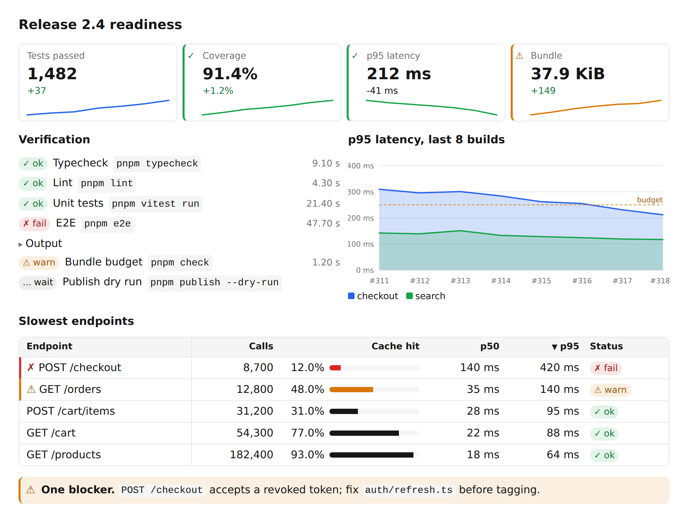
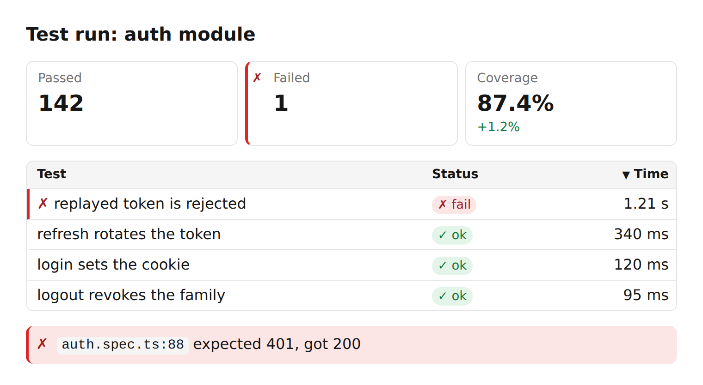
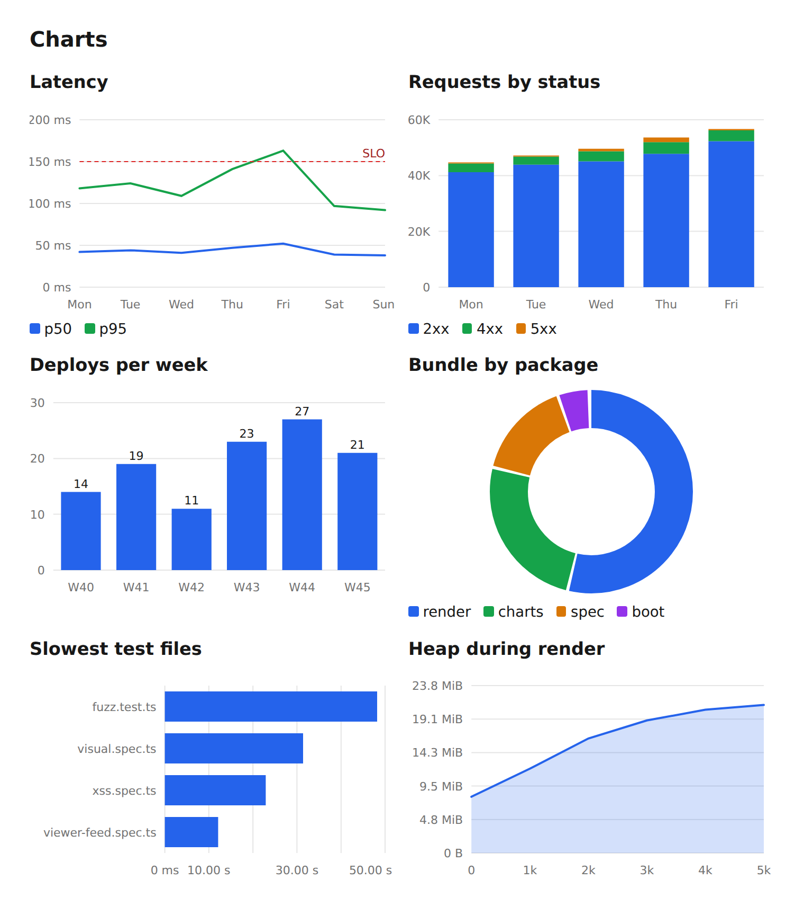
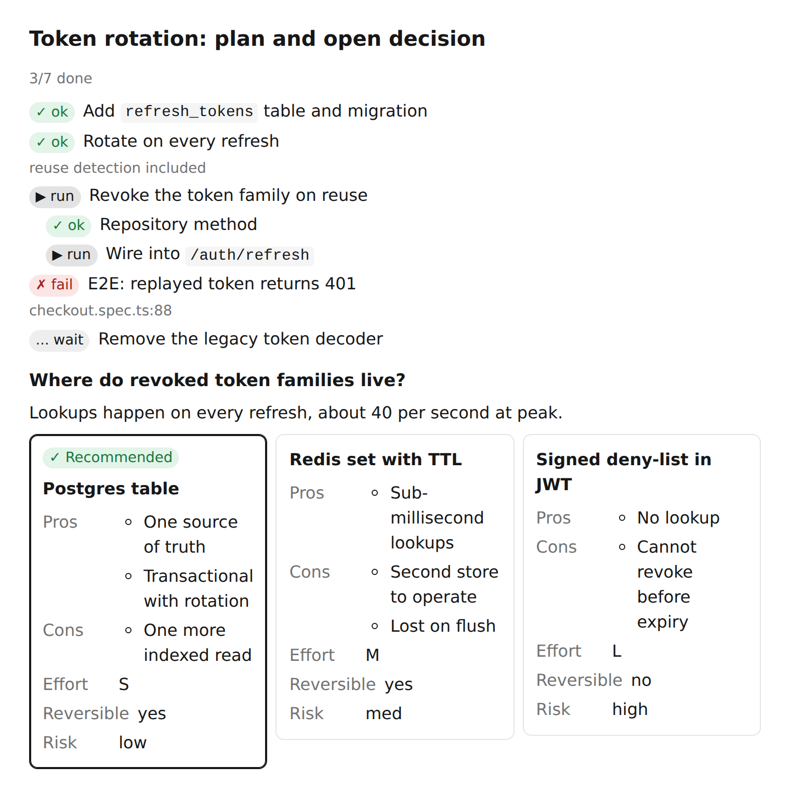
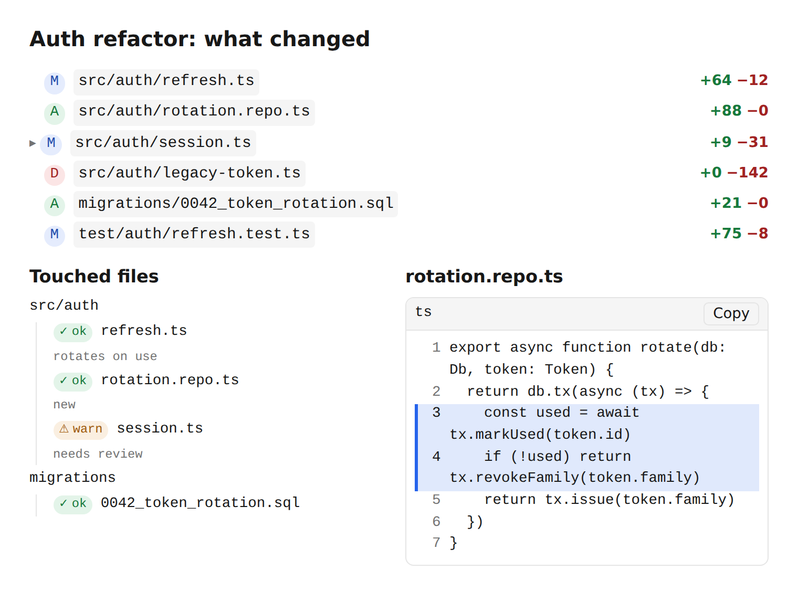
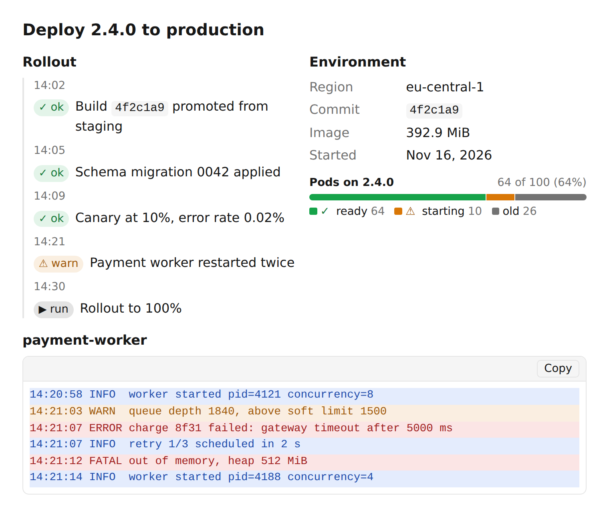
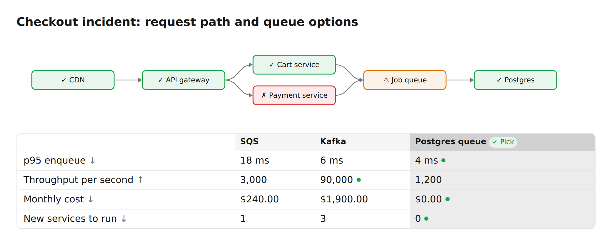
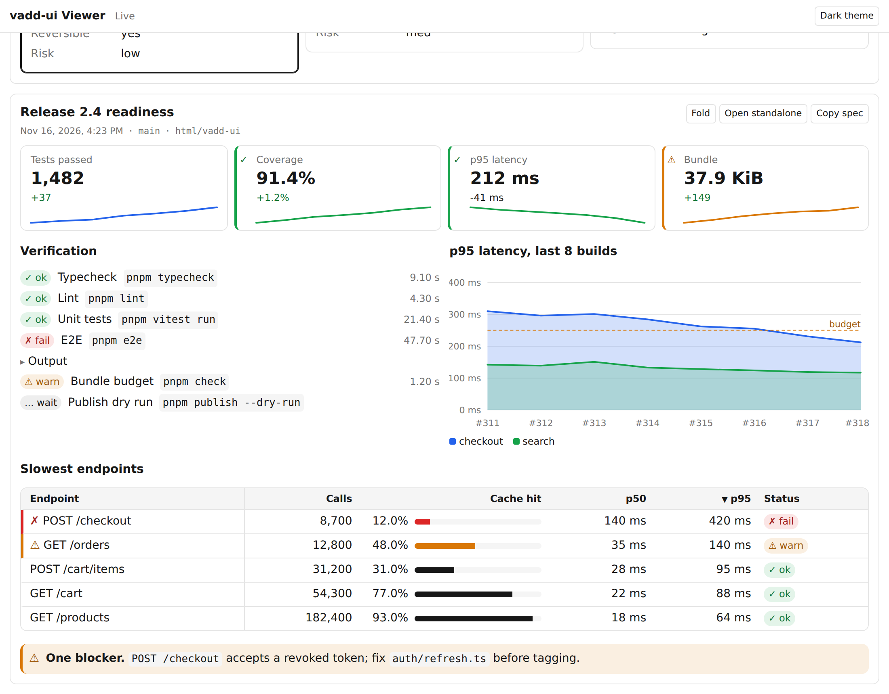

<h1 align="center">vadd-ui</h1>

<p align="center">
  <strong>Agents write 20 lines of JSON. You get a dashboard.</strong><br>
  A compact UI document format and a zero-dependency renderer for the things coding agents<br>
  keep explaining in walls of text: test runs, plans, diffs, metrics, charts and decisions.
</p>

<p align="center">
  <picture>
    <source media="(prefers-color-scheme: dark)" srcset="docs/assets/hero-dark.png">
    
  </picture>
</p>

<p align="center">
  <a href="docs/getting-started.md">Getting started</a> ·
  <a href="docs/components.md">Component gallery</a> ·
  <a href="docs/format.md">Document format</a> ·
  <a href="docs/embedding.md">Embedding</a>
</p>

---

## Why

An agent that has just run your test suite knows 140 results, six timings and one failure. Markdown makes it flatten all of that into a table you cannot sort and a paragraph you have to read twice. Hand-written HTML looks better, and costs four times the tokens, a different design every time, and a fresh chance of broken markup.

vadd-ui sits between the two. The agent describes **what the data is**; the renderer decides how it looks.

- **Small to write.** Positional rows, per-column formats and sensible defaults. Across the 24-case benchmark corpus a document costs about a quarter of the output tokens of equivalent hand-written HTML.
- **Hard to get wrong.** `vui` validates before showing and answers with a path and a hint (`/body/0: unknown type "tabel" (did you mean "table"?)`), so the agent fixes it in one retry.
- **One renderer everywhere.** The same document renders in the local Viewer, in Orca chat, as a single self-contained HTML file, and inside a React app.
- **Safe with untrusted input.** No `innerHTML`, no `eval`, no network requests. Bad input becomes a visible error card, never a blank frame or a script.
- **Light.** 24 components and 8 chart kinds in 37.9 KiB gzipped, with no runtime dependencies.

## From this to that

```js
{title: 'Test run: auth module', body: [
  {type: 'stats', items: [['Passed', 142], ['Failed', 1, null, null, null, 'err'], ['Coverage', 0.874, 'pct', 0.012, 'delta:pct']]},
  {type: 'table', columns: ['Test', 'Status:status', 'Time:ms'], sort: [2, 'desc'], rows: [
    ['refresh rotates the token', 'ok', 340],
    ['replayed token is rejected', 'fail', 1210, {tone: 'err'}],
    ['login sets the cookie', 'ok', 120],
    ['logout revokes the family', 'ok', 95],
  ]},
  {type: 'callout', tone: 'err', text: '`auth.spec.ts:88` expected 401, got 200'},
]}
```

<p align="center">
  <picture>
    <source media="(prefers-color-scheme: dark)" srcset="docs/assets/quick-dark.png">
    
  </picture>
</p>

Raw values in, formatted values out: `0.874` with `pct` becomes `87.4%`, `1210` with `ms` becomes `1.21 s`, and `'fail'` in a `status` column becomes a badge with an icon and a label. The agent never formats a number or picks a color.

## Quick start

The packages are not on npm yet, so for now build from a checkout (Node 22 or newer, pnpm through corepack):

```sh
git clone https://github.com/serhii-f8/vadd-ui.git && cd vadd-ui
corepack enable && pnpm install && pnpm build
alias vui="node $PWD/packages/ui-cli/dist/bin.js"
```

Show a document. `vui` starts the local Viewer on first use and opens it:

```sh
vui show --title "Release check" <<'EOF'
{body: [
  {type: 'checks', items: [
    {name: 'Unit', status: 'ok', ms: 21400},
    {name: 'E2E', status: 'fail', output: 'a.spec.ts:88 expected 401'},
  ]},
  {type: 'chart', kind: 'line', yFormat: 'ms', x: ['10:00', '10:05', '10:10'], series: {p95: [120, 88, 94]}},
]}
EOF
```

Or write one self-contained HTML file, with the renderer inlined, that opens anywhere:

```sh
vui render report.vui --format html --out report.html
```

Then teach your agent to do it by itself. One file is the whole install:

```sh
mkdir -p ~/.claude/skills/vadd-ui && cp skills/vadd-ui/SKILL.md ~/.claude/skills/vadd-ui/
```

More in [Getting started](docs/getting-started.md).

## What it draws

<table>
  <tr>
    <td width="50%" valign="top">
      <picture>
        <source media="(prefers-color-scheme: dark)" srcset="docs/assets/charts-dark.png">
        
      </picture>
      <p align="center"><strong>Charts</strong>: line, area, bar, hbar, stacked, donut, spark, scatter. Inline SVG, with a hidden data table for screen readers.</p>
    </td>
    <td width="50%" valign="top">
      <picture>
        <source media="(prefers-color-scheme: dark)" srcset="docs/assets/planning-dark.png">
        
      </picture>
      <p align="center"><strong>Plans and decisions</strong>: progress at a glance, and a fork laid out with pros, cons, effort and risk.</p>
    </td>
  </tr>
  <tr>
    <td valign="top">
      <picture>
        <source media="(prefers-color-scheme: dark)" srcset="docs/assets/changes-dark.png">
        
      </picture>
      <p align="center"><strong>Changes</strong>: diff summaries with folding hunks, file trees, and code with marked lines.</p>
    </td>
    <td valign="top">
      <picture>
        <source media="(prefers-color-scheme: dark)" srcset="docs/assets/ops-dark.png">
        
      </picture>
      <p align="center"><strong>Operations</strong>: timelines, key-value facts, segmented progress and logs with level highlighting.</p>
    </td>
  </tr>
</table>

<p align="center">
  <picture>
    <source media="(prefers-color-scheme: dark)" srcset="docs/assets/ext-dark.png">
    
  </picture>
</p>
<p align="center"><strong>Flows and comparisons</strong>: small directed graphs with automatic layout, and an options-by-criteria matrix that marks the best value in each row.</p>

All 24 components, with a copyable example for each, are in the [component gallery](docs/components.md).

| Group | Components |
| --- | --- |
| Layout | `stack` `grid` `section` `card` `tabs` `divider` |
| Text | `md` `callout` `code` |
| Data | `table` `kv` `stats` `list` `progress` `compare` |
| Charts | `chart` with `kind`: `bar` `hbar` `stacked` `donut` `line` `area` `spark` `scatter` |
| Dev workflow | `checks` `plan` `diff` `tree` `timeline` `decision` `log` `flow` |

## Where it runs

<p align="center">
  <picture>
    <source media="(prefers-color-scheme: dark)" srcset="docs/assets/viewer-dark.png">
    
  </picture>
</p>

| Host | How | Notes |
| --- | --- | --- |
| **Viewer** | `vui show` | A local live feed next to your terminal: every visual the agent shows, newest last, with light and dark themes. Works in native shells, WSL and over SSH. |
| **Orca chat** | `vui show` | Detected automatically; the visual lands inline in the chat and follows Orca's live theme. |
| **Any browser** | `vui render --format html` | One HTML file with the document and renderer inside. No server, no network. |
| **React** | `<VuiView doc={doc} />` | Renders in a shadow root, so your CSS and vadd-ui's cannot collide. |
| **Plain page** | `<script src="vui.min.js">` | Renders every `<script type="application/vui+json">` on the page. |
| **Terminal or markdown** | `vui render --format text` or `md` | The same document as aligned text, for hosts that draw nothing. |

The agent never chooses: `vui show` picks the host. Details in [Embedding](docs/embedding.md).

## Packages

| Package | What it is |
| --- | --- |
| [`@vadd/ui-cli`](packages/ui-cli) | The `vui` command: show, render, validate, catalog, bench. |
| [`@vadd/ui`](packages/ui) | The browser bundle, `vui.min.js`, and the `render` API. |
| [`@vadd/ui-react`](packages/ui-react) | `<VuiView>` for React 18 and 19. |
| [`@vadd/ui-render`](packages/ui-render) | The DOM renderer behind all of the above. |
| [`@vadd/ui-spec`](packages/ui-spec) | Parser, normalizer, validator, catalog and JSON Schema. No DOM. |
| [`@vadd/ui-text`](packages/ui-text) | Markdown and plain-text rendering. |
| [`@vadd/ui-viewer`](packages/ui-viewer) | The local Viewer server and feed. |
| [`skills/vadd-ui`](skills/vadd-ui) | The agent skill: when to show a visual and how. |

## Built to be trusted

A document is treated as untrusted input, because the agent that wrote it may have read hostile files, pages or logs.

- **No HTML sinks.** Text goes through `textContent`; markdown is parsed into nodes. A lint rule and a grep over the shipped bundles fail the build on `innerHTML`, `eval` or `new Function`.
- **Safe links only.** `http`, `https` and `mailto` become anchors; `javascript:` and `data:` render as text.
- **No network.** The renderer loads nothing and sends nothing.
- **Bounded work.** Size, depth, row and point limits, plus a watchdog that replaces a slow component with an error card.
- **Accessible.** Real tables and lists, keyboard-reachable controls, status never shown by color alone, and zero serious axe-core findings on every test page.
- **Tested.** About 7,500 unit tests, 500 browser tests in Chromium with Firefox and WebKit smoke runs, pixel baselines in both themes, an XSS suite over every text field, and a structure-aware fuzzer.

## Honest numbers

Measured on the bundled 24-case corpus with `vui bench` (offline token estimate):

| | Result | Target |
| --- | --- | --- |
| Tokens vs hand-written HTML, corpus total | 0.25× | 0.2× |
| Tokens vs markdown, corpus total | 1.4× | 1.2× |
| Fixed cost of one `vui show` call | 23 tokens | ≤ 30 |
| Agent skill size | 1,705 tokens | ≤ 1,800 |
| Core bundle, gzip | 37.9 KiB | ≤ 38 KiB |
| Agent's first document valid (40-prompt eval) | 97% | 98% |

The two token ratios and the first-try rate miss their targets and are logged as open items; charts and flows already beat 0.2×. The full audit is in [docs/vadd-ui/release/GOALS_AUDIT.md](docs/vadd-ui/release/GOALS_AUDIT.md).

## Development

```sh
pnpm install
pnpm gate     # build, typecheck, lint, unit tests with coverage, Playwright, budget checks
```

Choices made while building it are in [DECISIONS.md](docs/vadd-ui/DECISIONS.md). The screenshots on this page come from the documents in [`docs/assets/src`](docs/assets/src) and are regenerated with `node scripts/docs-screenshots.mjs`.

## License

Apache-2.0
