# Component gallery

All 24 components, each with a real document and what it renders. The examples are the bundled benchmark corpus (`packages/ui-cli/corpus`), so they are validated and pixel-tested with every build.

For the exact fields of a component, ask the CLI: `vui catalog table`. For the rules shared by all of them (common fields, formats, statuses, tones), see [Document format](format.md).

`compare`, `flow` and the `scatter` chart kind are the *ext* tier: they ship in `vui-ext.min.js`, which `vui` picks automatically when a document uses one.

**Layout:** [`stack`](#stack) [`grid`](#grid) [`section`](#section) [`card`](#card) [`tabs`](#tabs) [`divider`](#divider) · **Text:** [`md`](#md) [`callout`](#callout) [`code`](#code) · **Data:** [`table`](#table) [`kv`](#kv) [`stats`](#stats) [`list`](#list) [`progress`](#progress) [`compare`](#compare) · **Charts:** [`chart`](#chart) · **Dev workflow:** [`checks`](#checks) [`plan`](#plan) [`diff`](#diff) [`tree`](#tree) [`timeline`](#timeline) [`decision`](#decision) [`log`](#log) [`flow`](#flow)

## Layout

### stack

Vertical group.

<picture>
  <source media="(prefers-color-scheme: dark)" srcset="assets/components/stack-dark.png">
  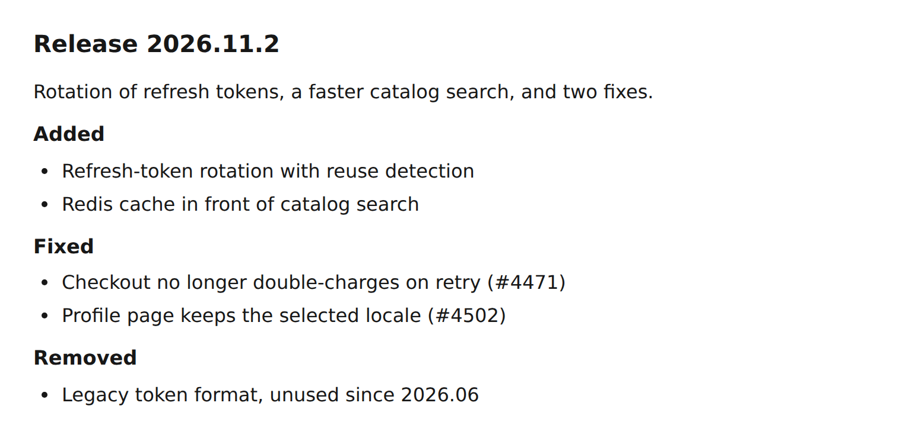
</picture>

<details>
<summary>Document</summary>

```js
{title: 'Release 2026.11.2', body: [
  {type: 'stack', children: [
    {type: 'md', text: 'Rotation of refresh tokens, a faster catalog search, and two fixes.'},
    {type: 'list', title: 'Added', items: ['Refresh-token rotation with reuse detection', 'Redis cache in front of catalog search']},
    {type: 'list', title: 'Fixed', items: ['Checkout no longer double-charges on retry (#4471)', 'Profile page keeps the selected locale (#4502)']},
    {type: 'list', title: 'Removed', items: ['Legacy token format, unused since 2026.06']},
  ]},
]}
```

</details>

### grid

Responsive columns; collapses to one column under 480 px.

<picture>
  <source media="(prefers-color-scheme: dark)" srcset="assets/components/grid-dark.png">
  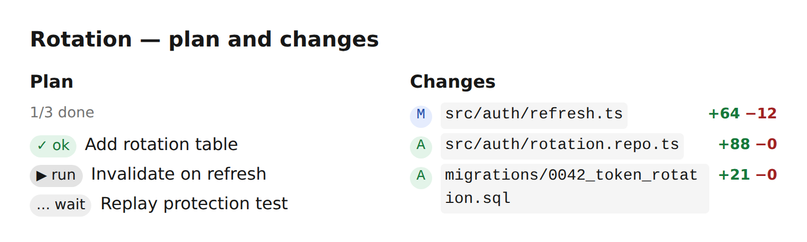
</picture>

<details>
<summary>Document</summary>

```js
{title: 'Rotation — plan and changes', body: [
  {type: 'grid', children: [
    {type: 'plan', title: 'Plan', items: [
      {text: 'Add rotation table', status: 'ok'},
      {text: 'Invalidate on refresh', status: 'run'},
      {text: 'Replay protection test', status: 'wait'},
    ]},
    {type: 'diff', title: 'Changes', files: [
      ['src/auth/refresh.ts', 64, 12, 'M'],
      ['src/auth/rotation.repo.ts', 88, 0, 'A'],
      ['migrations/0042_token_rotation.sql', 21, 0, 'A'],
    ]},
  ]},
]}
```

</details>

### section

Heading plus content.

<picture>
  <source media="(prefers-color-scheme: dark)" srcset="assets/components/section-dark.png">
  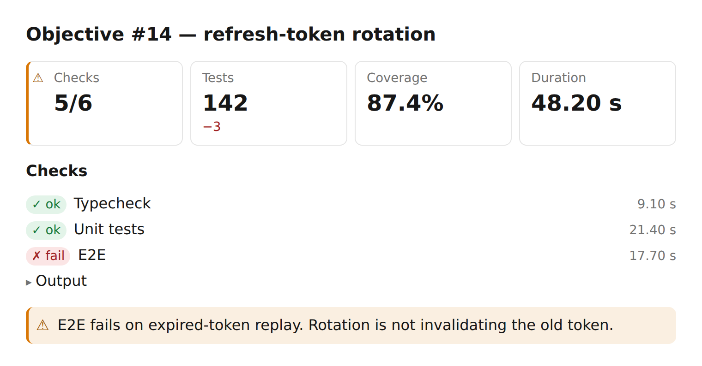
</picture>

<details>
<summary>Document</summary>

```js
{title: 'Objective #14 — refresh-token rotation', body: [
  {type: 'stats', items: [
    {label: 'Checks', value: '5/6', tone: 'warn'},
    {label: 'Tests', value: 142, delta: -3},
    {label: 'Coverage', value: 0.874, format: 'pct'},
    {label: 'Duration', value: 48200, format: 'ms'},
  ]},
  {type: 'section', title: 'Checks', children: [
    {type: 'checks', items: [
      {name: 'Typecheck', status: 'ok', ms: 9100},
      {name: 'Unit tests', status: 'ok', ms: 21400},
      {name: 'E2E', status: 'fail', ms: 17700, output: 'auth.spec.ts:88  expected 401, got 200'},
    ]},
  ]},
  {type: 'callout', tone: 'warn', text: 'E2E fails on expired-token replay. Rotation is not invalidating the old token.'},
]}
```

</details>

### card

Bordered surface.

<picture>
  <source media="(prefers-color-scheme: dark)" srcset="assets/components/card-dark.png">
  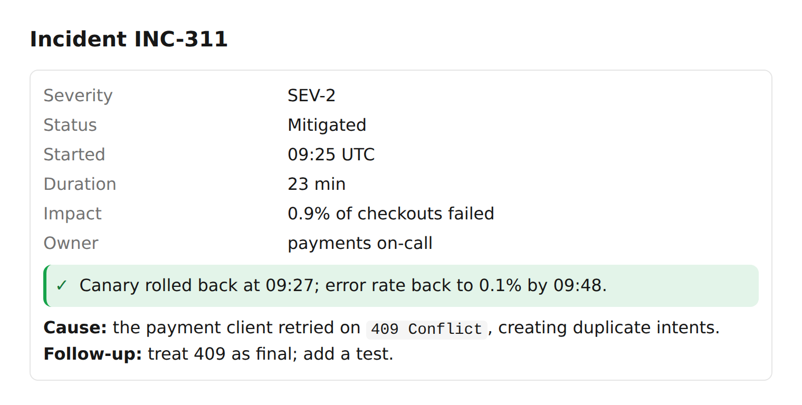
</picture>

<details>
<summary>Document</summary>

```js
{title: 'Incident INC-311', body: [
  {type: 'card', children: [
    {type: 'kv', pairs: {Severity: 'SEV-2', Status: 'Mitigated', Started: '09:25 UTC', Duration: '23 min', Impact: '0.9% of checkouts failed', Owner: 'payments on-call'}},
    {type: 'callout', tone: 'ok', text: 'Canary rolled back at 09:27; error rate back to 0.1% by 09:48.'},
    {type: 'md', text: '**Cause:** the payment client retried on `409 Conflict`, creating duplicate intents. **Follow-up:** treat 409 as final; add a test.'},
  ]},
]}
```

</details>

### tabs

One visible panel at a time.

<picture>
  <source media="(prefers-color-scheme: dark)" srcset="assets/components/tabs-dark.png">
  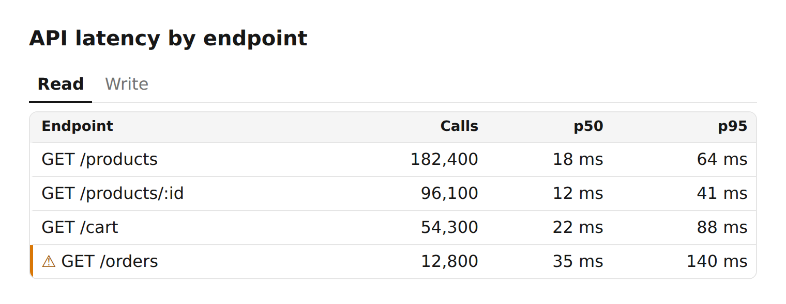
</picture>

<details>
<summary>Document</summary>

```js
{title: 'API latency by endpoint', body: [
  {type: 'tabs', tabs: [
    {label: 'Read', children: [
      {type: 'table', columns: ['Endpoint', 'Calls:int', 'p50:ms', 'p95:ms'], rows: [
        ['GET /products', 182400, 18, 64],
        ['GET /products/:id', 96100, 12, 41],
        ['GET /cart', 54300, 22, 88],
        ['GET /orders', 12800, 35, 140, {tone: 'warn'}],
      ]},
    ]},
    {label: 'Write', children: [
      {type: 'table', columns: ['Endpoint', 'Calls:int', 'p50:ms', 'p95:ms'], rows: [
        ['POST /cart/items', 31200, 28, 95],
        ['POST /checkout', 8700, 140, 420, {tone: 'err'}],
        ['PATCH /profile', 2100, 31, 77],
      ]},
    ]},
  ]},
]}
```

</details>

### divider

Horizontal rule.

<picture>
  <source media="(prefers-color-scheme: dark)" srcset="assets/components/divider-dark.png">
  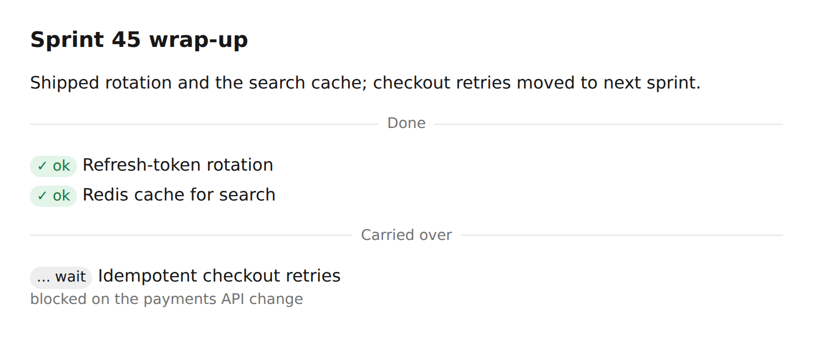
</picture>

<details>
<summary>Document</summary>

```js
{title: 'Sprint 45 wrap-up', body: [
  {type: 'md', text: 'Shipped rotation and the search cache; checkout retries moved to next sprint.'},
  {type: 'divider', label: 'Done'},
  {type: 'list', items: [{text: 'Refresh-token rotation', status: 'ok'}, {text: 'Redis cache for search', status: 'ok'}]},
  {type: 'divider', label: 'Carried over'},
  {type: 'list', items: [{text: 'Idempotent checkout retries', status: 'wait', note: 'blocked on the payments API change'}]},
]}
```

</details>

## Text

### md

Markdown block: inline subset, headings, lists, blockquote, fenced code.

<picture>
  <source media="(prefers-color-scheme: dark)" srcset="assets/components/md-dark.png">
  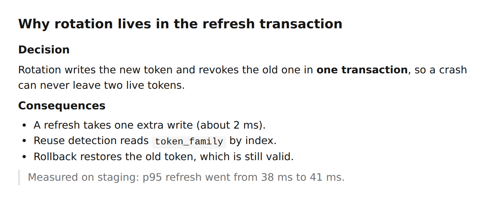
</picture>

<details>
<summary>Document</summary>

```js
{title: 'Why rotation lives in the refresh transaction', body: [
  {type: 'md', text: "### Decision\n\nRotation writes the new token and revokes the old one in **one transaction**, so a crash can never leave two live tokens.\n\n### Consequences\n\n- A refresh takes one extra write (about 2 ms).\n- Reuse detection reads `token_family` by index.\n- Rollback restores the old token, which is still valid.\n\n> Measured on staging: p95 refresh went from 38 ms to 41 ms."},
]}
```

</details>

### callout

Highlighted message.

<picture>
  <source media="(prefers-color-scheme: dark)" srcset="assets/components/callout-dark.png">
  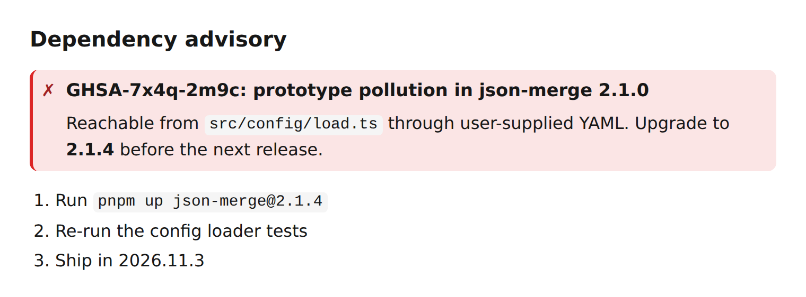
</picture>

<details>
<summary>Document</summary>

```js
{title: 'Dependency advisory', body: [
  {type: 'callout', tone: 'err', title: 'GHSA-7x4q-2m9c: prototype pollution in json-merge 2.1.0', text: 'Reachable from `src/config/load.ts` through user-supplied YAML. Upgrade to **2.1.4** before the next release.'},
  {type: 'list', ordered: true, items: [
    'Run `pnpm up json-merge@2.1.4`',
    'Re-run the config loader tests',
    'Ship in 2026.11.3',
  ]},
]}
```

</details>

### code

Monospace block with copy button, line numbers and highlighted lines.

<picture>
  <source media="(prefers-color-scheme: dark)" srcset="assets/components/code-dark.png">
  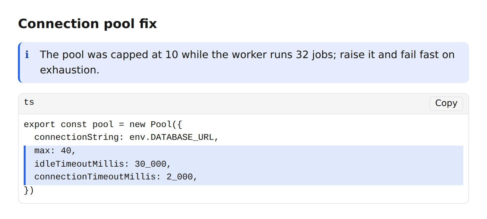
</picture>

<details>
<summary>Document</summary>

```js
{title: 'Connection pool fix', body: [
  {type: 'callout', tone: 'info', text: 'The pool was capped at 10 while the worker runs 32 jobs; raise it and fail fast on exhaustion.'},
  {type: 'code', lang: 'ts', mark: [3, 4, 5], text: "export const pool = new Pool({\n  connectionString: env.DATABASE_URL,\n  max: 40,\n  idleTimeoutMillis: 30_000,\n  connectionTimeoutMillis: 2_000,\n})"},
]}
```

</details>

## Data

### table

Tabular data with per-column formats, sort and paging.

<picture>
  <source media="(prefers-color-scheme: dark)" srcset="assets/components/table-dark.png">
  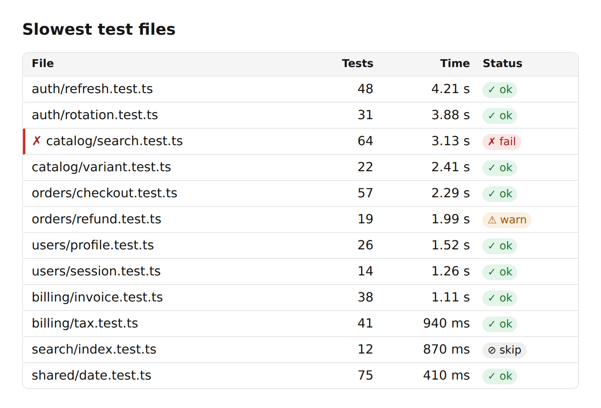
</picture>

<details>
<summary>Document</summary>

```js
{title: 'Slowest test files', body: [
  {type: 'table', columns: ['File', 'Tests:int', 'Time:ms', 'Status:status'],
   rows: [
    ['auth/refresh.test.ts', 48, 4210, 'ok'],
    ['auth/rotation.test.ts', 31, 3880, 'ok'],
    ['catalog/search.test.ts', 64, 3125, 'fail', {tone: 'err'}],
    ['catalog/variant.test.ts', 22, 2410, 'ok'],
    ['orders/checkout.test.ts', 57, 2290, 'ok'],
    ['orders/refund.test.ts', 19, 1985, 'warn'],
    ['users/profile.test.ts', 26, 1520, 'ok'],
    ['users/session.test.ts', 14, 1260, 'ok'],
    ['billing/invoice.test.ts', 38, 1105, 'ok'],
    ['billing/tax.test.ts', 41, 940, 'ok'],
    ['search/index.test.ts', 12, 870, 'skip'],
    ['shared/date.test.ts', 75, 410, 'ok'],
  ]},
]}
```

</details>

### kv

Key-value pairs.

<picture>
  <source media="(prefers-color-scheme: dark)" srcset="assets/components/kv-dark.png">
  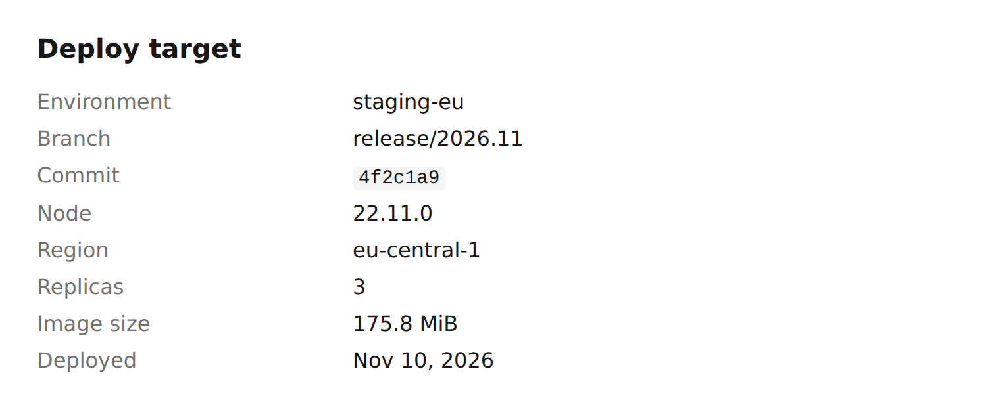
</picture>

<details>
<summary>Document</summary>

```js
{title: 'Deploy target', body: [
  {type: 'kv', pairs: [
    ['Environment', 'staging-eu'],
    ['Branch', 'release/2026.11'],
    ['Commit', '4f2c1a9', 'sha'],
    ['Node', '22.11.0'],
    ['Region', 'eu-central-1'],
    ['Replicas', 3, 'int'],
    ['Image size', 184320000, 'bytes'],
    ['Deployed', '2026-11-10T09:42:00Z', 'date'],
  ]},
]}
```

</details>

### stats

Metric tiles.

<picture>
  <source media="(prefers-color-scheme: dark)" srcset="assets/components/stats-dark.png">
  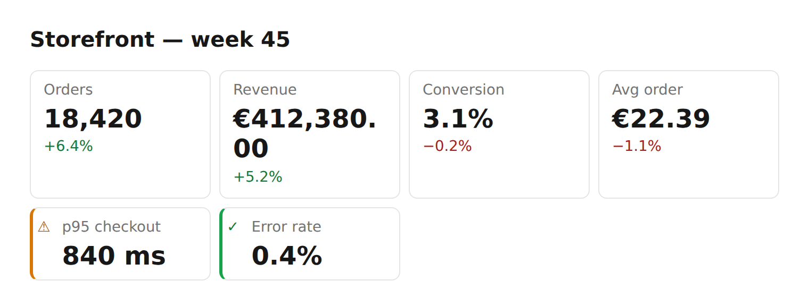
</picture>

<details>
<summary>Document</summary>

```js
{title: 'Storefront — week 45', body: [
  {type: 'stats', items: [
    ['Orders', 18420, 'int', 0.064, 'delta:pct'],
    ['Revenue', 412380, 'money:EUR', 0.052, 'delta:pct'],
    ['Conversion', 0.031, 'pct', -0.002, 'delta:pct'],
    ['Avg order', 22.39, 'money:EUR', -0.011, 'delta:pct'],
    ['p95 checkout', 840, 'ms', null, null, 'warn'],
    ['Error rate', 0.0042, 'pct', null, null, 'ok'],
  ]},
]}
```

</details>

### list

Items with status or icon.

<picture>
  <source media="(prefers-color-scheme: dark)" srcset="assets/components/list-dark.png">
  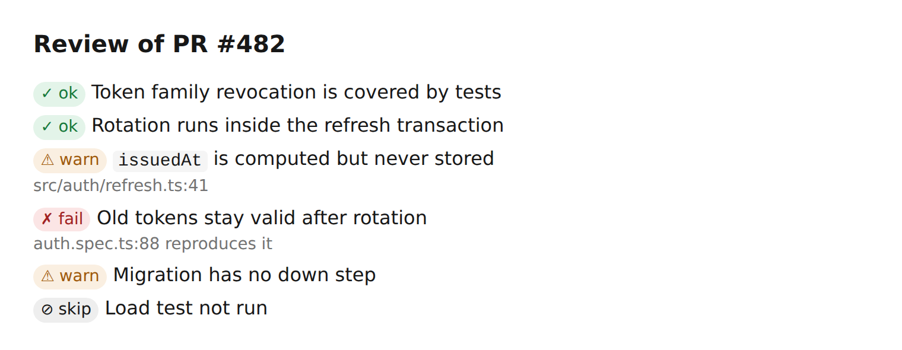
</picture>

<details>
<summary>Document</summary>

```js
{title: 'Review of PR #482', body: [
  {type: 'list', items: [
    {text: 'Token family revocation is covered by tests', status: 'ok'},
    {text: 'Rotation runs inside the refresh transaction', status: 'ok'},
    {text: '`issuedAt` is computed but never stored', status: 'warn', note: 'src/auth/refresh.ts:41'},
    {text: 'Old tokens stay valid after rotation', status: 'fail', note: 'auth.spec.ts:88 reproduces it'},
    {text: 'Migration has no down step', status: 'warn'},
    {text: 'Load test not run', status: 'skip'},
  ]},
]}
```

</details>

### progress

Bar or segmented progress.

<picture>
  <source media="(prefers-color-scheme: dark)" srcset="assets/components/progress-dark.png">
  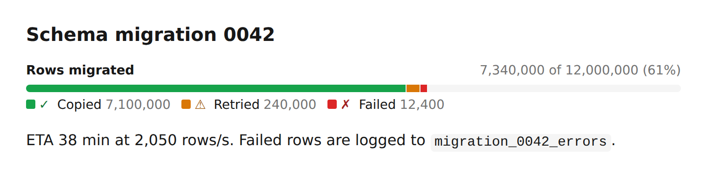
</picture>

<details>
<summary>Document</summary>

```js
{title: 'Schema migration 0042', body: [
  {type: 'progress', value: 7340000, max: 12000000, label: 'Rows migrated', segments: [
    {value: 7100000, tone: 'ok', label: 'Copied'},
    {value: 240000, tone: 'warn', label: 'Retried'},
    {value: 12400, tone: 'err', label: 'Failed'},
  ]},
  {type: 'md', text: 'ETA 38 min at 2,050 rows/s. Failed rows are logged to `migration_0042_errors`.'},
]}
```

</details>

### compare

Options by criteria matrix with a highlighted winner.

<picture>
  <source media="(prefers-color-scheme: dark)" srcset="assets/components/compare-dark.png">
  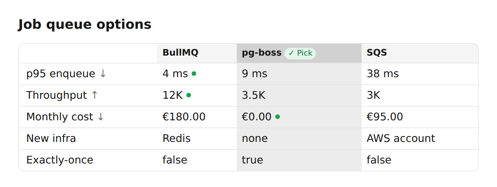
</picture>

<details>
<summary>Document</summary>

```js
{title: 'Job queue options', body: [
  {type: 'compare', options: ['BullMQ', 'pg-boss', 'SQS'], pick: 1, criteria: [
    {label: 'p95 enqueue', values: [4, 9, 38], format: 'ms', better: 'low'},
    {label: 'Throughput', values: [12000, 3500, 3000], format: 'compact', better: 'high'},
    {label: 'Monthly cost', values: [180, 0, 95], format: 'money:EUR', better: 'low'},
    {label: 'New infra', values: ['Redis', 'none', 'AWS account']},
    {label: 'Exactly-once', values: [false, true, false]},
  ]},
]}
```

</details>

## Charts

### chart

Inline SVG chart; kind picks the data shape.

<picture>
  <source media="(prefers-color-scheme: dark)" srcset="assets/components/chart-dark.png">
  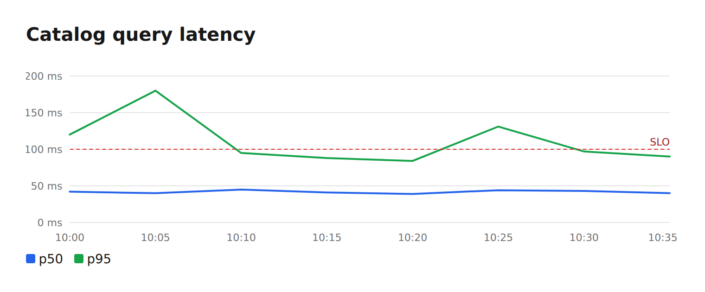
</picture>

<details>
<summary>Document</summary>

```js
{title: 'Catalog query latency', body: [
  {type: 'chart', kind: 'line', yFormat: 'ms',
   x: ['10:00', '10:05', '10:10', '10:15', '10:20', '10:25', '10:30', '10:35'],
   series: {p50: [42, 40, 45, 41, 39, 44, 43, 40], p95: [120, 180, 95, 88, 84, 131, 97, 90]},
   refLines: [{y: 100, label: 'SLO', tone: 'err'}]},
]}
```

</details>

All eight kinds (`scatter` not shown here):

<picture>
  <source media="(prefers-color-scheme: dark)" srcset="assets/charts-dark.png">
  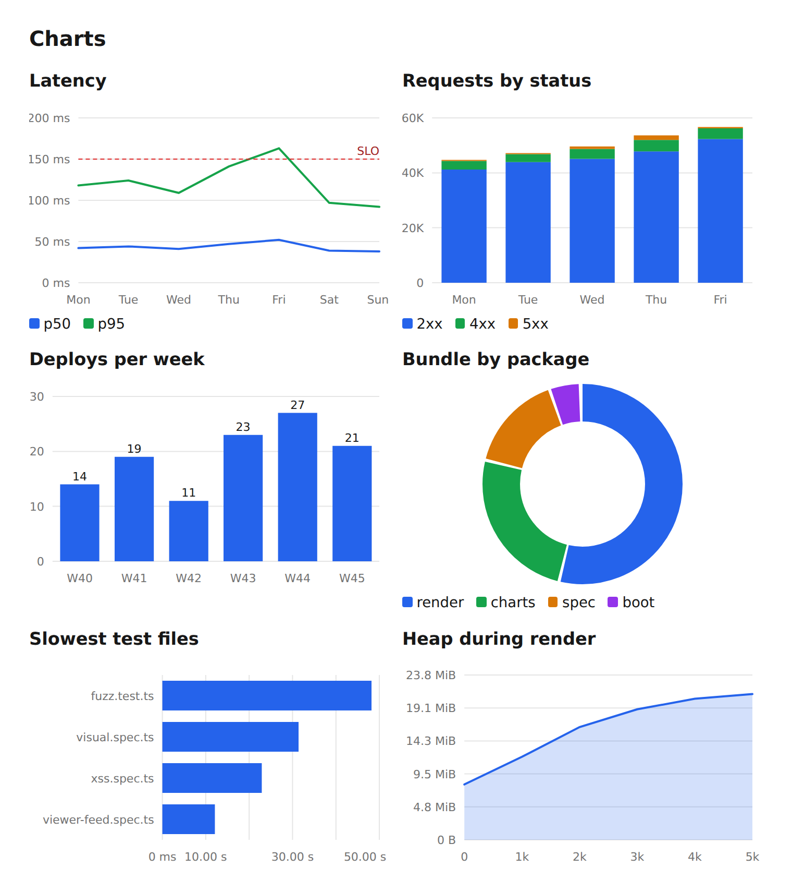
</picture>

| Kind | Data |
| --- | --- |
| `bar` `hbar` `stacked` `donut` | `x: string[]`, `series: {name: number[]}` |
| `line` `area` | `x: string[]` or `number[]`, `series: {name: number[]}` |
| `spark` | `values: number[]` |
| `scatter` | `points: [x, y, label?][]` |

`refLines` draws labelled thresholds; `yFormat` and `xFormat` take any [format](format.md#formats).

## Dev workflow

### checks

Verification results; output folds, last 20 lines shown.

<picture>
  <source media="(prefers-color-scheme: dark)" srcset="assets/components/checks-dark.png">
  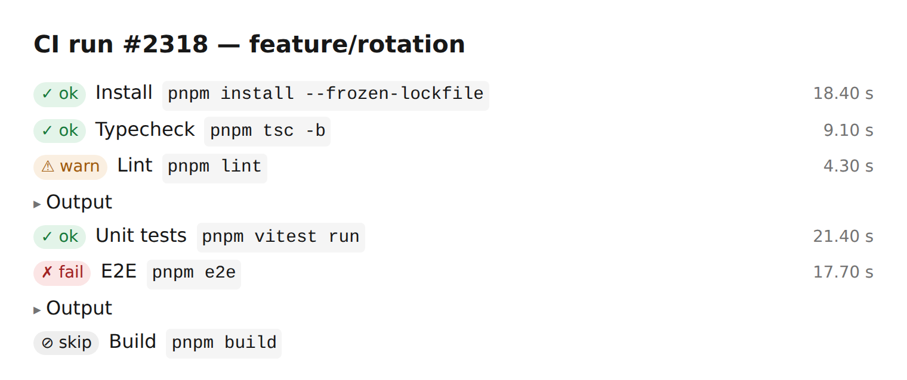
</picture>

<details>
<summary>Document</summary>

```js
{title: 'CI run #2318 — feature/rotation', body: [
  {type: 'checks', items: [
    {name: 'Install', status: 'ok', cmd: 'pnpm install --frozen-lockfile', ms: 18400},
    {name: 'Typecheck', status: 'ok', cmd: 'pnpm tsc -b', ms: 9100},
    {name: 'Lint', status: 'warn', cmd: 'pnpm lint', ms: 4300, output: 'src/auth/refresh.ts:41  unused variable "issuedAt"'},
    {name: 'Unit tests', status: 'ok', cmd: 'pnpm vitest run', ms: 21400},
    {name: 'E2E', status: 'fail', cmd: 'pnpm e2e', ms: 17700, output: 'auth.spec.ts:88  expected 401, got 200\nauth.spec.ts:112  expected token to be revoked'},
    {name: 'Build', status: 'skip', cmd: 'pnpm build'},
  ]},
]}
```

</details>

### plan

Task plan with progress; header shows done/total.

<picture>
  <source media="(prefers-color-scheme: dark)" srcset="assets/components/plan-dark.png">
  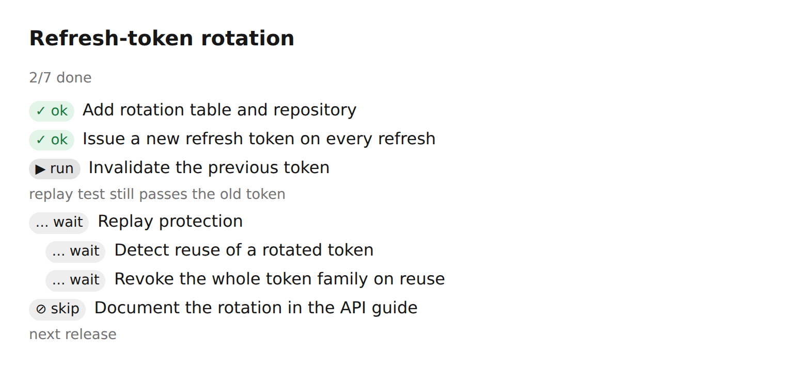
</picture>

<details>
<summary>Document</summary>

```js
{title: 'Refresh-token rotation', body: [
  {type: 'plan', items: [
    {text: 'Add rotation table and repository', status: 'ok'},
    {text: 'Issue a new refresh token on every refresh', status: 'ok'},
    {text: 'Invalidate the previous token', status: 'run', note: 'replay test still passes the old token'},
    {text: 'Replay protection', status: 'wait', children: [
      {text: 'Detect reuse of a rotated token', status: 'wait'},
      {text: 'Revoke the whole token family on reuse', status: 'wait'},
    ]},
    {text: 'Document the rotation in the API guide', status: 'skip', note: 'next release'},
  ]},
]}
```

</details>

### diff

Change summary.

<picture>
  <source media="(prefers-color-scheme: dark)" srcset="assets/components/diff-dark.png">
  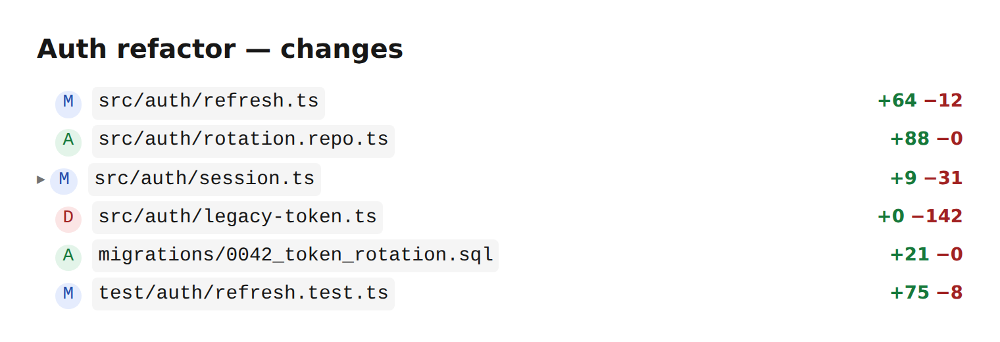
</picture>

<details>
<summary>Document</summary>

```js
{title: 'Auth refactor — changes', body: [
  {type: 'diff', files: [
    ['src/auth/refresh.ts', 64, 12, 'M'],
    ['src/auth/rotation.repo.ts', 88, 0, 'A'],
    ['src/auth/session.ts', 9, 31, 'M'],
    ['src/auth/legacy-token.ts', 0, 142, 'D'],
    ['migrations/0042_token_rotation.sql', 21, 0, 'A'],
    ['test/auth/refresh.test.ts', 75, 8, 'M'],
  ], hunks: {
    'src/auth/session.ts': '@@ -40,7 +40,4 @@\n-  const legacy = decodeLegacy(raw)\n-  if (legacy) return upgrade(legacy)\n+  return decode(raw)',
  }},
]}
```

</details>

### tree

File or object tree.

<picture>
  <source media="(prefers-color-scheme: dark)" srcset="assets/components/tree-dark.png">
  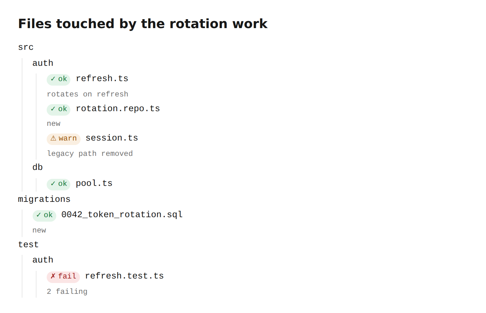
</picture>

<details>
<summary>Document</summary>

```js
{title: 'Files touched by the rotation work', body: [
  {type: 'tree', items: [
    {name: 'src', children: [
      {name: 'auth', children: [
        {name: 'refresh.ts', status: 'ok', note: 'rotates on refresh'},
        {name: 'rotation.repo.ts', status: 'ok', note: 'new'},
        {name: 'session.ts', status: 'warn', note: 'legacy path removed'},
      ]},
      {name: 'db', children: [{name: 'pool.ts', status: 'ok'}]},
    ]},
    {name: 'migrations', children: [{name: '0042_token_rotation.sql', status: 'ok', note: 'new'}]},
    {name: 'test', children: [{name: 'auth', children: [{name: 'refresh.test.ts', status: 'fail', note: '2 failing'}]}]},
  ]},
]}
```

</details>

### timeline

Ordered events; at is an ISO time or a label.

<picture>
  <source media="(prefers-color-scheme: dark)" srcset="assets/components/timeline-dark.png">
  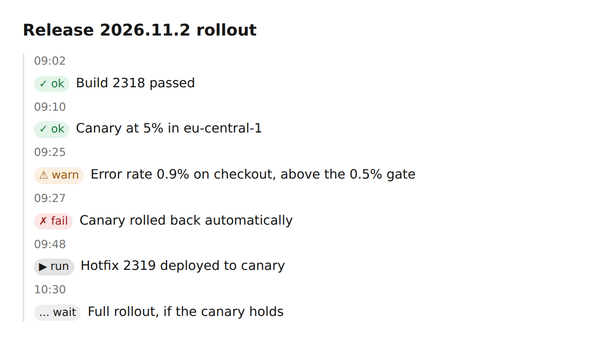
</picture>

<details>
<summary>Document</summary>

```js
{title: 'Release 2026.11.2 rollout', body: [
  {type: 'timeline', items: [
    {at: '09:02', text: 'Build 2318 passed', status: 'ok'},
    {at: '09:10', text: 'Canary at 5% in eu-central-1', status: 'ok'},
    {at: '09:25', text: 'Error rate 0.9% on checkout, above the 0.5% gate', status: 'warn'},
    {at: '09:27', text: 'Canary rolled back automatically', status: 'fail'},
    {at: '09:48', text: 'Hotfix 2319 deployed to canary', status: 'run'},
    {at: '10:30', text: 'Full rollout, if the canary holds', status: 'wait'},
  ]},
]}
```

</details>

### decision

A fork that needs a choice; pick marks the recommendation.

<picture>
  <source media="(prefers-color-scheme: dark)" srcset="assets/components/decision-dark.png">
  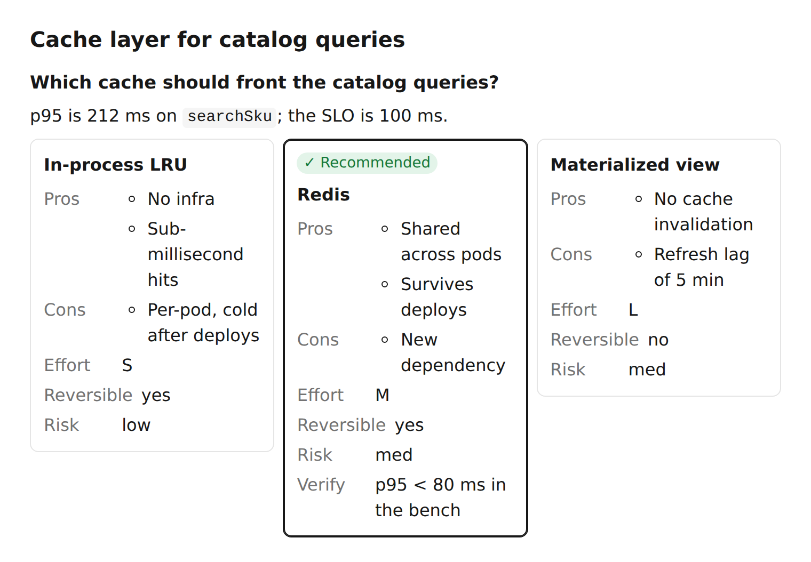
</picture>

<details>
<summary>Document</summary>

```js
{title: 'Cache layer for catalog queries', body: [
  {type: 'decision', question: 'Which cache should front the catalog queries?', pick: 1,
   context: 'p95 is 212 ms on `searchSku`; the SLO is 100 ms.',
   options: [
    {label: 'In-process LRU', pros: ['No infra', 'Sub-millisecond hits'], cons: ['Per-pod, cold after deploys'], effort: 'S', reversible: true, risk: 'low'},
    {label: 'Redis', pros: ['Shared across pods', 'Survives deploys'], cons: ['New dependency'], effort: 'M', reversible: true, risk: 'med', verify: 'p95 < 80 ms in the bench'},
    {label: 'Materialized view', pros: ['No cache invalidation'], cons: ['Refresh lag of 5 min'], effort: 'L', reversible: false, risk: 'med'},
  ]},
]}
```

</details>

### log

Log excerpt with level highlighting.

<picture>
  <source media="(prefers-color-scheme: dark)" srcset="assets/components/log-dark.png">
  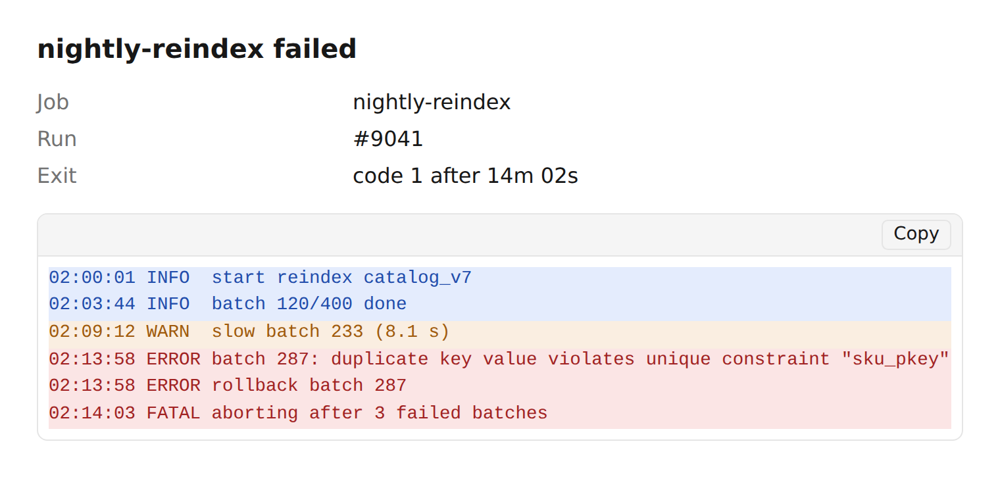
</picture>

<details>
<summary>Document</summary>

```js
{title: 'nightly-reindex failed', body: [
  {type: 'kv', pairs: {Job: 'nightly-reindex', Run: '#9041', Exit: 'code 1 after 14m 02s'}},
  {type: 'log', text: "02:00:01 INFO  start reindex catalog_v7\n02:03:44 INFO  batch 120/400 done\n02:09:12 WARN  slow batch 233 (8.1 s)\n02:13:58 ERROR batch 287: duplicate key value violates unique constraint \"sku_pkey\"\n02:13:58 ERROR rollback batch 287\n02:14:03 FATAL aborting after 3 failed batches"},
]}
```

</details>

### flow

Small directed graph with layered auto-layout.

<picture>
  <source media="(prefers-color-scheme: dark)" srcset="assets/components/flow-dark.png">
  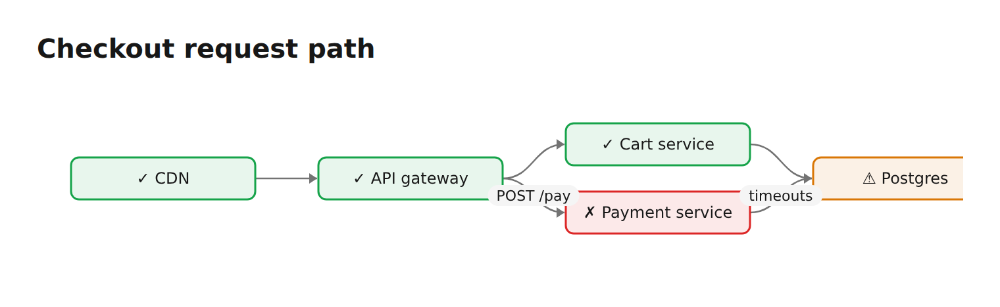
</picture>

<details>
<summary>Document</summary>

```js
{title: 'Checkout request path', body: [
  {type: 'flow', nodes: [
    {id: 'cdn', label: 'CDN', status: 'ok'},
    {id: 'api', label: 'API gateway', status: 'ok'},
    {id: 'cart', label: 'Cart service', status: 'ok'},
    {id: 'pay', label: 'Payment service', status: 'fail'},
    {id: 'db', label: 'Postgres', status: 'warn'},
  ], edges: [
    ['cdn', 'api'],
    ['api', 'cart'],
    ['api', 'pay', 'POST /pay'],
    ['cart', 'db'],
    ['pay', 'db', 'timeouts'],
  ]},
]}
```

</details>
