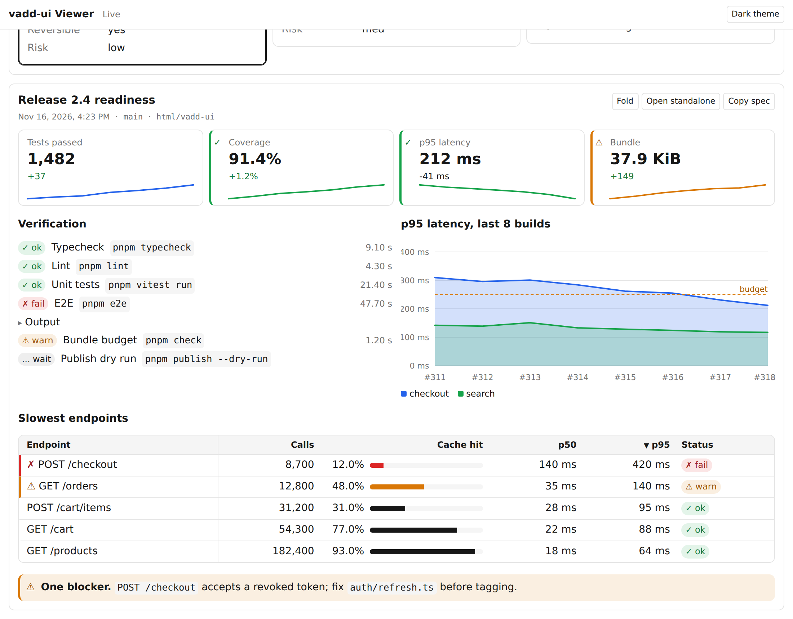

# Embedding

One renderer, six places to put it. Pick by where the reader is.

| You want | Use |
| --- | --- |
| An agent's results next to your terminal | [the Viewer](#the-viewer) |
| Results inline in Orca chat | [Orca chat](#orca-chat) |
| A file to attach, archive or open offline | [standalone HTML](#standalone-html) |
| A visual inside a React app | [`<VuiView>`](#react) |
| A visual on any web page | [the script tag](#script-tag) or [the JavaScript API](#javascript-api) |
| Text for a host that draws nothing | [markdown and plain text](#markdown-and-plain-text) |

## The Viewer

<picture>
  <source media="(prefers-color-scheme: dark)" srcset="assets/viewer-dark.png">
  
</picture>

```sh
vui show report.vui            # or pipe a document on stdin
vui show --title "Release check" --no-open < report.vui
```

The Viewer is a small local server with a live feed page. `vui show` starts it when needed, sends the document, and opens the page the first time. Each entry can be folded, opened as a standalone page, or copied back out as its source document. The page follows the system color scheme and has a manual toggle.

It is built for the places agents actually run:

- **One Viewer per workspace.** State lives under `~/.local/state/vadd-ui/`, keyed by the workspace folder.
- **Local only.** It binds to `127.0.0.1` and serves the feed under an unguessable path.
- **WSL and SSH.** `vui` detects the environment and prints the URL to open when it cannot open a browser itself. `vui viewer start --bind <address>` changes the bind address when the default cannot be reached from your browser.
- **Inside Orca**, the feed opens in Orca's browser pane beside the terminal.

```sh
vui viewer start | stop | status | open | url
vui doctor        # explains what was detected and why
```

## Orca chat

In Orca's structured chat, `vui show` writes a self-contained visual file to the chat's scratch folder and prints a directive:

```text
::orca-visual{file="release-check-a91f.html" title="Release check"}
```

The agent pastes that line into its reply and Orca draws the visual inline. Colors come from Orca's live theme tokens, so a theme switch restyles it without a re-render. The agent does not choose this path: host selection is automatic, and `--host viewer`, `--host orca-chat` or `--host file` override it when you need to.

## Standalone HTML

```sh
vui render report.vui --format html --out report.html
```

The output is one file with the document and the minified renderer inside, about 115 KB. It needs no server and makes no network requests, so it works as a CI artifact, an email attachment or a page on an internal wiki. It follows `prefers-color-scheme`.

Add `--cdn` to reference the renderer from a CDN instead of inlining it. The file shrinks to roughly the size of the document, at the cost of needing network access and the published package.

To get the document back out of any such file:

```sh
vui extract report.html
```

## React

```tsx
import { VuiView } from '@vadd/ui-react'

export function Report({ doc }: { doc: string }) {
  return <VuiView doc={doc} theme="auto" onDiagnostics={(list) => console.debug(list)} />
}
```

| Prop | Type | Meaning |
| --- | --- | --- |
| `doc` | `VuiDocument \| string` | The document, as an object or as source text. Changing it updates in place. |
| `theme` | `'auto' \| 'light' \| 'dark'` | `auto` (the default) follows the system scheme. |
| `onDiagnostics` | `(diagnostics) => void` | Called with the diagnostics of each render. |

`<VuiView>` renders into a shadow root, so your stylesheet and vadd-ui's cannot affect each other. Host design tokens (`--background`, `--card`, `--foreground` and friends, as in shadcn/ui) still inherit into it, which is how it picks up your theme. React 18 and 19 are supported.

## Script tag

```html
<!doctype html><meta charset="utf-8">
<script src="vui.min.js"></script>
<script type="application/vui+json">
{title: 'Report', body: [{type: 'md', text: 'Done'}]}
</script>
```

On load, the bundle finds every `<script type="application/vui+json">`, renders it into a sibling `<div class="vui-root">`, and injects its stylesheet once. Inside the embedded document, write `</` as `<\/`.

`vui.min.js` holds the core components (37.9 KiB gzipped). `vui-ext.min.js` adds `compare`, `flow` and `scatter` charts (42.7 KiB gzipped); use it instead when a document needs them. Both are in `packages/ui/dist` after a build.

## JavaScript API

```ts
import { render } from '@vadd/ui'

const handle = render(source, document.getElementById('report')!, {
  diagnostics: 'badge',                    // 'hidden' | 'badge' | 'panel'
  linkHandler: (url) => window.open(url),  // optional: take over link clicks
})

handle.diagnostics        // what the validator found
handle.update(nextSource) // re-render in place, keeping sort, folds and tabs
handle.destroy()
```

`render` accepts source text or a document object and never throws to the host: a document that cannot be parsed renders an error card with the message and the first lines of the input. The script-tag bundle exposes the same function as `window.VUI.render`.

The exported `stylesheet` string is the full CSS, for hosts that mount into their own shadow root.

## Markdown and plain text

```sh
vui render report.vui --format md
vui render report.vui --format text
```

Both use the same formatting functions as the DOM renderer, so `87.4%` and `1.21 s` read the same everywhere. From code, `@vadd/ui-text` exports `renderMarkdown(doc)` and `renderPlain(doc)`.

## Theming

vadd-ui reads design tokens through CSS custom properties with built-in fallbacks and never redefines them. A host that already defines `--background`, `--foreground`, `--card`, `--border`, `--muted-foreground` and similar tokens gets matching visuals with no configuration; a host that defines none gets the built-in light and dark palettes.

## Browser support

Chromium 111 or newer for full fidelity (tinted surfaces use `color-mix()`), with Firefox and WebKit covered by smoke tests. Details in [RUNTIME_SUPPORT.md](vadd-ui/release/RUNTIME_SUPPORT.md).
